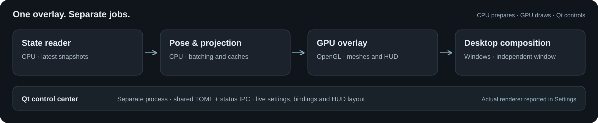
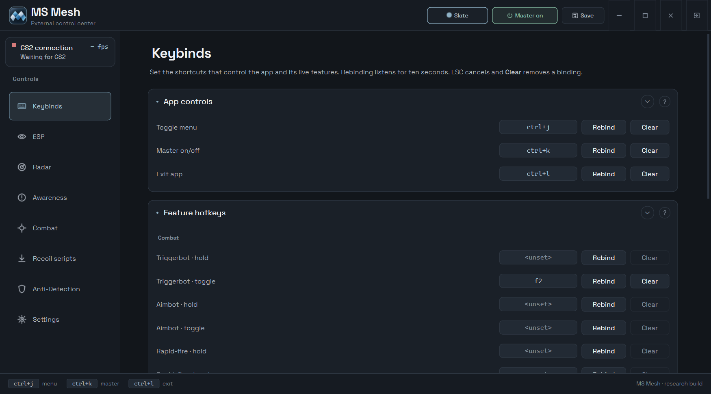
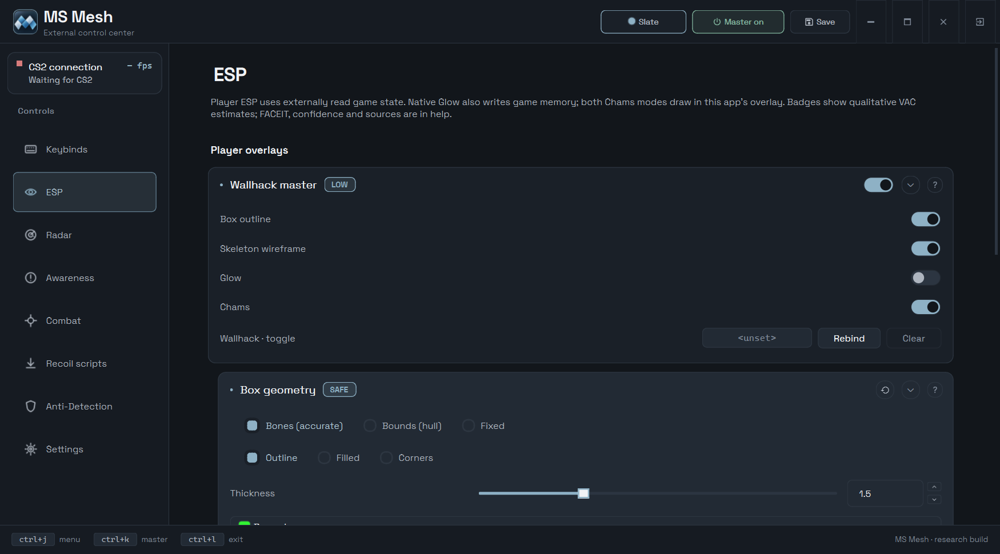
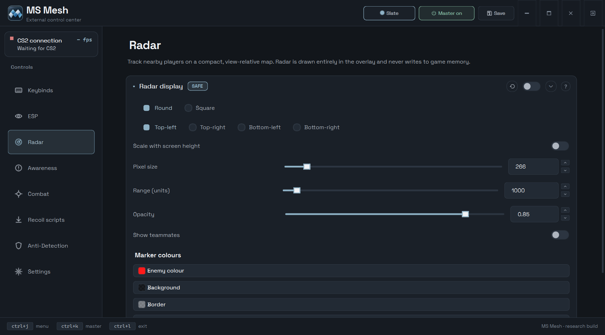
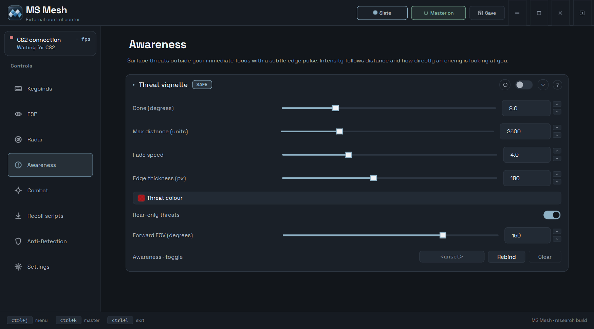
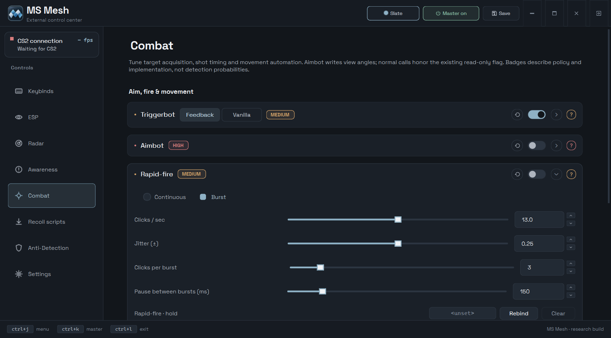
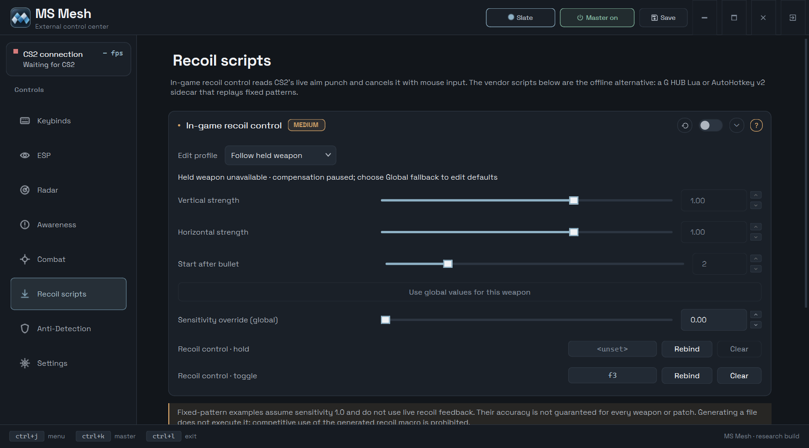
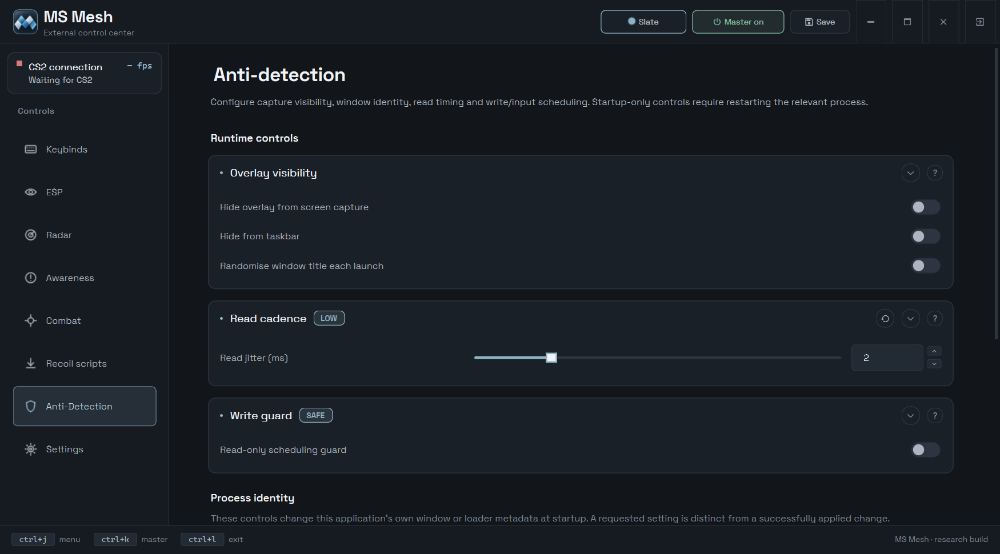
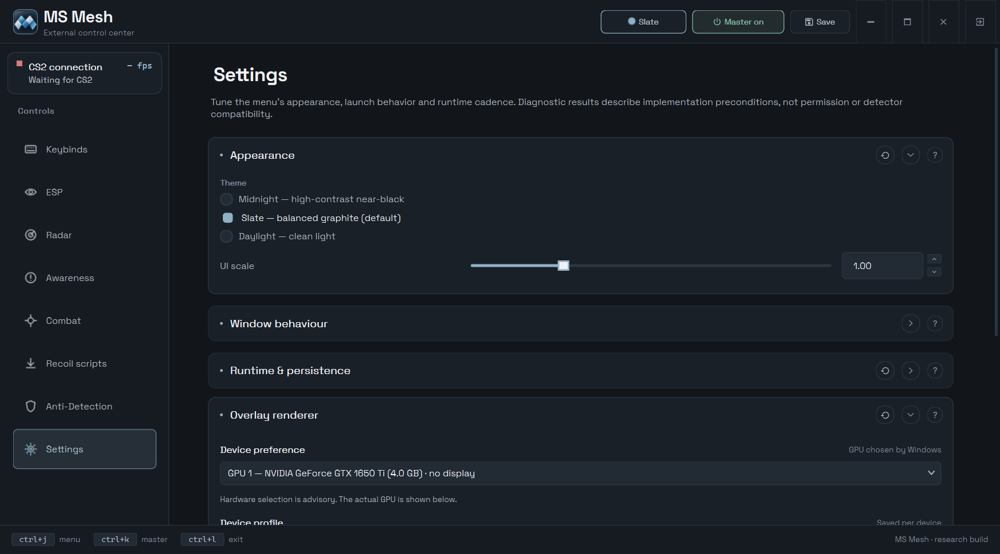

# MS Mesh · CS2 ESP

A Windows x64 external overlay with a separate Qt control center. Python handles the application; native C++ helpers accelerate mesh decoding and overlay maths. No DLL is injected into the game.

[Download APP](https://github.com/MS-Mesh/CS2ESP-Python/releases) · [Telegram channel](https://t.me/ms_mesh) · [Telegram contact](https://t.me/test_number2) · [Discord contact](https://discord.com/users/492755314127536179) · [Русский](#ru)



## Features

| Area | Features |
|---|---|
| Player visuals | Bone/bounds boxes, skeleton and head outline, exact VPK-model or legacy Chams, engine Glow, health/name/distance labels and the currently held weapon |
| Radar & Awareness | View-relative radar with pixel/relative sizing, teammate colours and a directional threat vignette |
| Combat | Feedback/Vanilla Triggerbot, curved-path Aimbot, live recoil control and BHop |
| Clickers | Rapid-fire with continuous/burst patterns; weapon-aware Auto-pistol for supported semi-auto handguns |
| HUD & events | Movable/scalable widgets, local combat notifications, weapon/outcome icons, spectators, C4 timer, hotkeys and telemetry |
| Sound | Separate hit, headshot-hit, kill, headshot-kill and one-tap cues; per-family file, volume and mute |
| Control center | Eight tabs, three themes, DPI-aware layouts, live binding sync, scoped Reset with confirmation and on-demand offset updates |

## How it works

The application reads game state on the CPU and draws a separate transparent overlay over the CS2 window. The Qt control center manages settings and communicates with the runtime without becoming part of the game process.

Rendering uses OpenGL. **Device preference is advisory:** Windows chooses the adapter; Settings shows the actual renderer. Per-device profiles control state-reader cadence, not the available features. Selecting a GPU does not move game-state reads or all application work off the CPU.

## Run

**Standalone APP:** download `cs2esp.exe` from Releases, put it in a writable folder and run it. Python is not required. The app creates an editable `config/` next to the executable.

**From source:** use 64-bit Python 3.11+ on Windows. The current build is tested with Python 3.14.

```powershell
py -3.14 -m venv .venv
.\.venv\Scripts\python.exe -m pip install -r requirements.txt
.\.venv\Scripts\python.exe main.py
```

| Default shortcut | Action |
|---|---|
| `Ctrl+J` | Show/hide the menu |
| `Ctrl+K` | Master on/off |
| `Ctrl+L` | Quit the whole app |

Set feature Hold/Toggle bindings in **Keybinds**; each editor stays in sync with its feature page. The menu's **close button** hides only the menu while CS2 runs; after CS2 closes, it exits both processes. **Quit** always exits everything.

## Menu

The control center has eight sections and three themes: **Midnight**, **Slate** and **Daylight**. UI scale and appearance are configurable in Settings.

<table>
<tr><td width="50%"><strong>Keybinds</strong><br></td><td width="50%"><strong>ESP</strong><br></td></tr>
<tr><td><strong>Radar</strong><br></td><td><strong>Awareness</strong><br></td></tr>
<tr><td><strong>Combat</strong><br></td><td><strong>Recoil scripts</strong><br></td></tr>
<tr><td><strong>Anti-Detection</strong><br></td><td><strong>Settings</strong><br></td></tr>
</table>

## Configuration

- Settings are stored in `config/default.toml` and saved from the menu. Source launches use the project's `config/`; packaged builds use the folder beside their executable.
- **Update Offsets** works in source and APP launches. It refreshes the local cache and reports whether a running overlay accepted and verified the update.
- **Reset** restores saved reference parameters, colours and sizes for that component. It asks first; bindings and ON/OFF switches stay as they are.
- **HUD Edit Mode** is for layout. Its Reset restores HUD positions/scales, not feature settings.
- Telemetry shows `--` when a measurement is unavailable. Software frame timings are not a measurement of visible end-to-end latency.
- Menu and overlay logs are stored separately under `config/logs/`, with bounded retention.

## Build

Two build modes use the same entry point and feature set:

| Mode | Command | Output | Use |
|---|---|---|---|
| APP | `python build/build.py --app` | `build/APP/cs2esp.exe` | Single-file application without a console; includes Python and runtime assets |
| DEV | `python build/build.py --dev` | `build/DEV/cs2esp.exe` plus dependencies | Directory build with a console for logs and debugging; keep the whole output folder |

Runtime resources and native-helper sources are centralized under `cs2esp/`; `build/` contains the packaging driver and generated APP/DEV output.

Neither packaged mode needs a separate Python installation. Source launches need the dependencies above. Rebuilding preserves an existing APP config; logs, model caches and IPC files are excluded from the package. Release downloads are packaged snapshots and may differ from development source.

First launch uses the settings embedded from `config/default.toml`. An existing `config/default.toml` beside the EXE takes priority, including saved HUD positions and sizes. To deliberately make a local build match the current source settings, use `python build/build.py --app --sync-config` (or `--dev --sync-config`); the previous build settings are backed up first. Normal launches and rebuilds do not reset user preferences.

To rebuild the native helpers, install Visual Studio's **Desktop development with C++** workload and run:

```powershell
.\cs2esp\native\vpkmesh\build.bat
.\cs2esp\native\overlayperf\build.bat
.\cs2esp\native\inputguard\build.bat
```

## Contributing

Pull requests, issues and collaboration are welcome. Bug reports are most useful with the source/build version, Windows and GPU details, reproduction steps and the relevant crash log. For UI issues, add a screenshot and display scale.

For development, install the published [requirements-dev.txt](requirements-dev.txt); it includes runtime dependencies and the optional pytest/Hypothesis tools:

```powershell
.\.venv\Scripts\python.exe -m pip install -r requirements-dev.txt
```

Regression tests and internal audit notes are not included in the public source distribution. APP users do not need development dependencies. Native sources are in `cs2esp/native/`, WAV sounds in `cs2esp/sounds/`, and overlay fonts in `cs2esp/assets/fonts/`.

---

## RU

**MS Mesh** — внешний оверлей CS2 для Windows x64 с отдельным меню на Qt. Логика приложения написана на Python, а нативные C++ модули ускоряют разбор моделей и вычисления оверлея. DLL в процесс игры не внедряется.

### Возможности

- Визуалы игроков: боксы по костям или границам, скелет и обводка головы, Chams с точными VPK-моделями или прежней геометрией, Glow, здоровье, имена, расстояния и активное оружие.
- Радар с размером в пикселях или долях высоты экрана, цветами команд и направленной подсветкой угроз.
- Feedback/Vanilla Triggerbot, Aimbot с криволинейным движением, активный контроль отдачи и BHop.
- Rapid-fire с непрерывными кликами или сериями. Auto-pistol работает с поддерживаемыми полуавтоматическими пистолетами и учитывает готовность оружия.
- Перемещаемые и масштабируемые HUD-компоненты, локальные боевые события, иконки оружия и действий, наблюдатели, таймер C4, бинды и телеметрия.
- Раздельные звуки попадания, попадания в голову, убийства, убийства в голову и one-tap; для каждой категории выбираются файл, громкость и отключение.
- Восемь вкладок, три темы, масштабирование под DPI, синхронизация биндов, Reset с подтверждением и обновление оффсетов из меню.

### Как это устроено

Приложение читает состояние игры на CPU и рисует отдельный прозрачный оверлей поверх окна CS2. Меню Qt управляет настройками и общается с runtime, не становясь частью процесса игры.

Отрисовка работает через OpenGL. Выбор устройства является предпочтением: адаптер назначает Windows, а фактическое устройство показано в Settings. Профили для устройств управляют частотой чтения данных, а не набором функций. Выбор видеокарты не переносит на неё чтение памяти и всю остальную работу CPU.

### Запуск и управление

Готовый APP находится в Releases. Положи `cs2esp.exe` в доступную для записи папку и запусти: отдельный Python не нужен. Рядом появится `config/`; существующий конфиг сохраняется при пересборке.

Для запуска исходников нужен 64-битный Python 3.11+ под Windows; текущая сборка проверяется на Python 3.14. Создай виртуальное окружение, установи `requirements.txt` и запусти `main.py` командами из английского раздела.

`Ctrl+J` показывает меню, `Ctrl+K` переключает master, `Ctrl+L` полностью завершает приложение. Бинды функций настраиваются в Keybinds и синхронизируются с профильными разделами. Пока CS2 работает, крестик закрывает только меню; после закрытия игры он завершает оба процесса. Quit всегда закрывает всё.

В меню восемь разделов и три темы: Midnight, Slate и Daylight. Масштаб и оформление интерфейса настраиваются в Settings.

### Настройки

Настройки сохраняются в `config/default.toml`. При запуске исходников используется папка проекта, а в готовых сборках — `config/` рядом с EXE.

Update Offsets работает и из исходников, и в APP: обновляет кэш и сообщает результат применения в запущенном оверлее. Reset возвращает сохранённые параметры, цвета и размеры выбранного компонента после подтверждения, не меняя бинды и переключатели. Reset внутри HUD-редактора отвечает только за позиции и масштабы.

Если измерение недоступно, телеметрия показывает `--`. Время программных этапов кадра не равно видимой задержке всей цепочки вывода. Раздельные логи меню и оверлея сохраняются в `config/logs/`; старые записи ограничены по количеству.

### Сборка

Нативные модули пересобираются скриптами в `cs2esp/native/` с установленным C++ workload Visual Studio. `build/build.py --app` создаёт `build/APP/cs2esp.exe`, а `--dev` — консольную сборку в `build/DEV/`. Существующий APP-конфиг сохраняется при пересборке; логи, модельный кэш и IPC-файлы в пакет не входят. Опубликованные релизы могут отличаться от исходников в разработке.

APP — один EXE без консоли; DEV — папка с EXE, зависимостями и консолью для диагностики. Оба режима используют одинаковые функции и не требуют отдельного Python. Команды и пути вывода приведены в таблице выше; DEV нужно переносить целиком.

При первом запуске используются встроенные настройки из `config/default.toml`. Если рядом с EXE уже есть `config/default.toml`, приложение использует его, включая сохранённые позиции и размеры HUD. Для намеренной синхронизации локальной сборки с текущими настройками исходников запусти `python build/build.py --app --sync-config` или `--dev --sync-config`: прежний конфиг предварительно сохраняется в резервную копию. Обычный запуск и пересборка не сбрасывают пользовательские настройки.

### Разработка и сотрудничество

Буду рад pull request, issues и совместной работе. В баг-репорте укажи версию исходников/сборки, Windows, видеокарту и шаги воспроизведения; приложи нужный лог без личных данных. Для проблем интерфейса полезны скриншот и масштаб экрана. Для разработки установи опубликованный [requirements-dev.txt](requirements-dev.txt): он включает runtime-зависимости и инструменты pytest/Hypothesis. Внутренние регрессионные тесты и рабочие заметки не входят в публичный репозиторий; пользователям APP dev-зависимости не нужны.

Канал: [t.me/ms_mesh](https://t.me/ms_mesh). Связь: [t.me/test_number2](https://t.me/test_number2). Discord: [MS Mesh](https://discord.com/users/492755314127536179).
